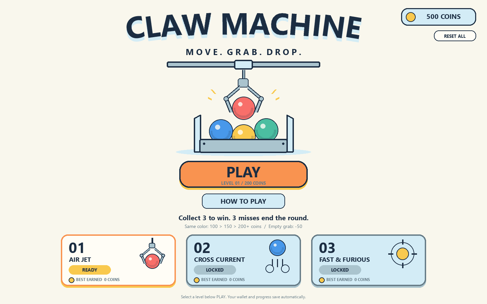

# CLAW MACHINE

A small desktop arcade experience: aim, catch a moving ball, and carry it to the
guarded collection bay. Collect **3 balls** before **3 empty grabs** end the round.
Play through **three levels** with a persistent coin wallet and same-color bonuses.

Created for the individual SD5913 Assignment 3. The intended user is someone who
wants a short, mouse-controlled arcade game with readable feedback and a clear goal.
The interface is entirely English and drawn as flat vector-style shapes.



## Run

Use Python 3.12 and `uv`. From PowerShell, **inside this folder**:

```powershell
uv run --no-project --python 3.12 main.py
```

On Windows, double-click **PLAY.cmd** for the same command. Its working directory
is set automatically, so spaces in the folder name are supported. The first run
may download Python/Pygame if they are not already cached. Later runs need no
network, account, API key, camera or microphone.

If you have Python 3.12 but do not use `uv`:

```powershell
py -3.12 -m venv .venv
.\.venv\Scripts\python.exe -m pip install -r requirements.txt
.\.venv\Scripts\python.exe main.py
```

The inline script metadata pins Pygame 2.6.1 and Python >=3.10,<3.14. The commands
above select 3.12 consistently. The game is separate from the teacher's `pfad`
repository and its Week 4 environment.

## Play

Select an unlocked level on the start screen, then press **PLAY / 200 COINS**.
Each level entry, including NEXT LEVEL and RETRY, costs **200 coins**.
The illustrated level cards along the bottom select the level; the centered
PLAY button shows the selected level and entry fee. The top-right badge shows
your wallet, with RESET ALL directly below it.

1. **MOVE:** move the mouse inside the arena. The carriage follows horizontally
   at a limited speed. The dashed guide shows its current aim.
2. **GRAB:** click inside the arena or press the GRAB button. The claw lowers,
   closes and returns to the rail. The balls keep moving throughout the attempt.
3. **DROP:** if a ball is held, move left above the short collection bay. When
   **CLICK TO DROP** appears, click to release it through the opening.

A successful grip does not award a point immediately: the ball must reach the
tray. A miss is counted once when an empty claw returns. The right panel shows
each delivered ball and the remaining room for mistakes.

- **Space / Esc:** pause or resume.
- **R / RETRY:** open a confirmation to retry the current level for 200 coins.
- **Enter:** the same action as the main button.
- **NEXT LEVEL / PLAY AGAIN:** a new paid entry after the result screen.
- Moving to another window automatically pauses the round; press Space on return.
- Resize the window freely; the game keeps its aspect ratio and input coordinates.

## Coins, levels and saved progress

| Rule | Coins |
| --- | ---: |
| New campaign / confirmed RESET ALL | 500 initial coins |
| Every level entry or retry | -200 |
| Empty grab | -50, stopping at zero |
| First delivered ball of each color | +100 |
| Second / third ball of that color | +150 / +200 |
| Each further ball of that color | Previous reward +50 |

The color totals persist across levels and retries. A hold earns nothing until
the ball reaches the left tray. The right panel shows the wallet, collected balls,
misses and the next reward for each color. Results include entry, rewards, penalties
and net earnings. Best earnings mean gross rewards in a completed round.

1. **AIR JET:** the original filled cabinet, with a right-side upward air jet.
2. **CROSS CURRENT:** an initially empty cabinet. Three left jets launch balls
   toward a right-side recycler. Catch in transit and carry LEFT to score.
3. **FAST & FURIOUS:** faster launches, changed jet angles/heights and occasional
   capsule-shaped bullets. Bullets cannot be held; a failed attempt is an empty
   grab. A mandatory illustrated explanation appears before every Level 3 entry.
   Reading it is free; its START button charges the fee.

Free balls entering the right recycler never count as misses. Every level still
requires three deliveries before three empty grabs. Only a win unlocks the next
level. The faster streams use a faster claw close but retain opposing-contact
checks. Bullets are pass-through hazards, with no damage or health mechanic.

Below 200 coins, a new entry is disabled; **RESET ALL** is the way to start over.
Its confirmation erases funds, unlocks, color counts and best earnings, restoring
500 coins and Level 1. A paid round can continue at zero coins and still earn rewards.
Opening instructions, pausing and cancelling a retry never charge a fee.

Progress is saved after each charge, reward, penalty and result. On Windows the
file is `%LOCALAPPDATA%\ClawMachine\progress.json`, outside the source repository.
Closing during a paid round ends that round without refund; the wallet, deliveries
already rewarded and unlocked levels remain saved. Reopening requires a new paid
entry. A corrupt save shows a warning and requires an explicit RESET ALL. A failed
write shows an in-game warning and retains the current session in memory.

## How the interaction works

`Ball` stores position, velocity, radius and colour. The model advances at a
fixed 120 Hz, independently of the rendered frame rate. Balls collide with each
other, the box and the guarded bay. Settled balls gently drift right; actual
contact with the nozzle gives them an upward/leftward impulse back into the box.

The claw is a small state machine:

```text
MOVE -> LOWER -> CLOSE -> LIFT -> CARRY -> DROP -> MOVE
                           |                    |
                     empty: +1 miss       delivered: +1 ball
                           |                    |
                      3 misses: LOST      3 balls: WON
```

The grip is determined by geometry, not a success probability. A ball must be
inside the pocket, touch both opposing lower fingers, and have the closing tips
below its centre with a gap narrow enough to retain it. Only then is a kinematic
hold constraint created. The ball's current offset is retained rather than
teleporting a distant ball into the claw. The hold remains stable during carry.

The **short** left bay leaves the entire overhead transport corridor open. Its
hatch opens for a verified delivery. An admission filter keeps ordinary free
balls outside the bay even during the brief opening; only the currently held
and released ball can enter or score. This is an explicit arcade rule.

## Mistakes and interruptions

- Clicking over the collector to begin a grab gives a move-right hint.
- Clicking while the claw is busy cannot create extra attempts or misses.
- Clicking outside the drop alignment keeps the ball held and gives a hint.
- A single-finger touch or a ball outside the pocket does not count as a grip.
- Pausing freezes the entire round, including animations and scoring.
- Paid retry clears the current held ball, gate permission, misses and round tray;
  it preserves the campaign wallet and color totals after charging the entry.

## Checks

Model checks use only the Python standard library:

```powershell
uv run --no-project --python 3.12 python -m unittest -v test_game test_campaign
```

The event-loop integration check uses Pygame and a headless display:

```powershell
uv run --no-project --python 3.12 --with pygame==2.6.1 python -m unittest -v test_game test_campaign test_ui test_fonts
```

The tests cover real opposing contacts, misses, the guarded opening, delivery,
win/loss/reset, nozzle contact, pause, frame-rate consistency and actual event-loop
click/key handling. Font regressions also verify startup with broken system-font
discovery, missing font files and a corrupt font file. Automated checks do **not**
replace the required human user trial.

Documentation screenshots can be reproduced without opening a window:

```powershell
uv run --no-project --python 3.12 main.py --screenshot assets/menu.png
uv run --no-project --python 3.12 main.py --scene level3 --screenshot assets/level3.png
uv run --no-project --python 3.12 main.py --scene drop --screenshot assets/gameplay-drop.png
```

`scenes.py` is used only by screenshot mode. Its carry/drop snapshots replay real
physics and successful catches. The win/loss screenshots use labelled layout
fixtures. Normal gameplay never calls these helpers.

## Files

- `main.py`: window, mouse/keyboard input and main loop.
- `model.py`: `Ball`, collision/grip logic and the round state machine.
- `campaign.py`: paid entries, rewards, unlocks and atomic progress storage.
- `view.py`, `app_view.py`: English flat illustration, menu and campaign screens.
- `test_game.py`, `test_campaign.py`, `test_ui.py`, `test_fonts.py`: behavioural checks.
- `PROCESS.md`: design decisions, AI use and a clearly pending user-trial record.
- `CREDITS.md`: course influence, tools and asset provenance.
- `assets/`: actual rendered screenshots and the corrected design reference.

## Known limitations and next work

This is intentionally a 2D arcade simulation. Its valid-contact hold is simplified:
there is no full rigid-body claw solver, grip-force simulation or random slipping.
There are no sound effects, touch controls or live website. Saves are local to
this computer; there is no account or cloud synchronization.
Timing and difficulty still need a real participant trial. System font selection
may differ slightly between computers. On Windows, known Segoe UI files are
loaded directly without enumerating the font registry; missing or unusable files
fall back to Pygame's bundled font. The interface is vector-style, rendered
to pixels by Pygame; the reference PNG is not an editable SVG.

Before submitting, complete the real user trial in `PROCESS.md`, follow these
instructions from a fresh terminal, and submit this project's public GitHub
repository URL through Canvas.

